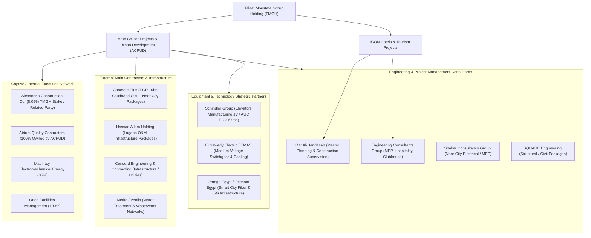

# FORENSIC DUE DILIGENCE & COMPREHENSIVE RISK INVESTIGATION
## Talaat Moustafa Group Holding (TMG Holding — EGX: TMGH)
**Investigation Date / Cut-Off:** 11 October 2026  
**Investigative Scope:** Full Project Portfolio (Egypt & Cross-Border), Supply-Chain Mapping, Customer Sentiment & Disputes, Contractual & Regulatory Exposures, Audited Financial Forensic Analysis, and Project-by-Project Risk Register.  
**Lead Investigator:** Senior Forensic Due Diligence & Construction Supply-Chain Practice  

---

## 1. EXECUTIVE SUMMARY & EVIDENCE HARNESS

### 1.1 Scope & Analytical Baseline
This forensic investigation synthesizes verified primary disclosures (TMG Holding audited financial statements through FY2025, interim reviewed statements to 30 June 2026, EGX regulatory disclosures, investor relations presentations), court decisions (Egyptian State Council / Supreme Administrative Court), regulatory filings (Consumer Protection Agency / Financial Regulatory Authority), independent investigative reporting (ARIJ, Reuters, Enterprise, Al Manassa), and field-level supply-chain and customer data.

### 1.2 Core Analytical Findings
1. **Financial Solvency vs. Cash Conversion Lag:**  
   TMG is not in immediate liquidity distress. Liquid resources at 30 June 2026 stand at EGP 47.11bn in cash and cash equivalents, and approximately EGP 66.4bn when including current time deposits and treasury instruments. However, cash conversion displays a structural gap: H1 2026 Net Operating Cash Flow was **EGP 3.11bn** against a consolidated net profit of **EGP 9.95bn** (a cash-conversion ratio of ~31%), driven by an EGP 18.26bn cash absorption into properties under development and working capital.
2. **Financing Structure & Hidden Debt Equivalent:**  
   While headline bank loans are moderate at **EGP 16.5bn** (30 June 2026, up from EGP 11.8bn at Dec 2025), TMG has heavily leveraged off-balance/structured financing: **Financial Lease Notes Payable stand at EGP 43.99bn** following extensive sale-and-leaseback transactions on commercial and recurring assets. Blended borrowing costs on EGP facilities average **28.6%**, creating an aggressive financing drag if unit handover or collection velocity slows.
3. **Contracted Sales Normalization & Asset-Light Shift:**  
   Following an exceptional EGP 504.0bn in contracted sales in FY2024 (spurred by the launch of SouthMed on the North Coast), FY2025 contracted sales normalized down **24% YoY to EGP 382.2bn**. TMG has deliberately shifted toward an **asset-light master-developer model** for mega-projects (SouthMed and The Spine), capturing an ~8% development fee rather than carrying the full land-balance-sheet and delivery-default liabilities.
4. **Supply-Chain Architecture & Captive Contracting Concentration:**  
   TMG relies on a **hybrid closed-loop procurement model**. Core civil, infrastructure, and security works are dominated by internal subsidiaries and affiliated vehicles: **Alexandria Construction Company** (a related-party contractor owned outside the direct consolidated subsidiary perimeter but holding an ~8.05% equity stake in TMGH) and **Atrium Quality Contractors** (100% owned via ACPUD). External Tier-1 contractors (e.g., Concrete Plus with ~EGP 10bn awards in SouthMed and Noor City) are brought in primarily for overflow capacity, villa clustering, and specialized MEP packages.
5. **Customer Friction Points & Legal Disputes:**  
   Customer friction is heavily concentrated in post-handover recurring charges:
   - **Maintenance Deficits ("فروق الصيانة"):** Systematic disputes over demands for supplementary maintenance payments beyond initial deposits without independent certified accounting logs.
   - **Resale Transfer Fees ("رسوم التنازل"):** Widespread developer practice of assessing 5%–10% transfer fees upon resale, directly challenged by Article 15 of Egyptian Consumer Protection Law No. 181/2018 (which voids such clauses), triggering regulatory enforcement and individual civil litigation.
   - **Delivery Slippages:** Handover delays of 12 to 24 months in secondary phases of Celia and hotel developments (Four Seasons Luxor, Radisson Collection Marsa Alam, Four Seasons Madinaty).
6. **Key-Person & Land Title Legacy:**  
   Strategic decisions, public-sector negotiations, and land allocations remain highly centralized under CEO Hesham Talaat Moustafa (pardoned in 2017 with subsequent judicial rehabilitation). Historical scrutiny regarding direct land allocations (2010 Madinaty Supreme Administrative Court ruling and 2023 ARIJ investigative report) underscores that project stability depends on state partnership alignment (NUCA, ACUD, Ministry of Housing).

---

## 2. COMPLETE CORPORATE STRUCTURE & SUBSIDIARY TREE

*Source: TMG Holding Consolidated Financial Statements as of 30 June 2026 (Note 2), FY2025 Audited Statements (Note 2), and EGX Corporate Governance Filings. Evidence Strength: HIGH.*

### 2.1 Major Shareholders (as of 31 Dec 2025 / 30 June 2026)
- **TMG for Real Estate & Tourism Investment:** 43.22% (Family holding vehicle)
- **Alexandria Construction Company:** 8.05% (Related-party construction contractor)
- **RIMCO EGT Investment LLC:** 7.49% (Saudi/Gulf institutional investor)
- **Social Insurance Fund for Government Sector Employees:** ~6.00% (Egyptian state entity)
- **Free Float (EGX):** ~35.24%

### 2.2 Verified Corporate Hierarchy & Ownership Chains
```
Talaat Moustafa Group Holding (TMGH) [Listed on EGX: TMGH]
│
├── 1. Arab Company for Projects and Urban Development (ACPUD) — 99.99%
│   ├── Madinaty Management Company ..................................... 88.00%
│   ├── El Rehab for Management ........................................ 91.00%
│   ├── Celia Management Company ....................................... 100.00%
│   ├── Atrium Quality Contractors (AQC) ............................... 100.00%
│   │   ├── Atrium Projects Management ................................. 99.00%
│   │   ├── Atrium Advanced Building ................................... 100.00%
│   │   └── Atrium Sustain Development ................................. 98.50%
│   ├── Engineering Company for Development Building ................... 83.36%
│   ├── Madinaty Electromechanical Energy .............................. 85.00%
│   ├── Orion Facilities Management .................................... 100.00%
│   ├── Orion Urban Development ........................................ 75.50%
│   ├── TM Trade & Distribution ........................................ 100.00%
│   ├── Newton Advanced Technologies ................................... 100.00%
│   ├── Madinaty Medical Centre ........................................ 100.00%
│   ├── Emilio Interiors ............................................... 70.00%
│   ├── El Rehab Securitization ........................................ 100.00%
│   ├── Alex Gardens ................................................... 93.95%
│   ├── Arab Egyptian Entertainment .................................... 50.00%
│   ├── Saini Blues Diving ............................................. 95.00%
│   ├── Arab International Investment (Cayman) ......................... 100.00%
│   ├── International Projects Investments (Cayman) .................... 100.00%
│   ├── [CROSS-BORDER] TMG Saudi Arabia for RE Development (KSA) ....... 60.00%
│   │   └── Banan City (Riyadh) Project Vehicle & Iraq Licence Holder
│   ├── [CROSS-BORDER] Atrium Saudi .................................... 100.00%
│   └── [CROSS-BORDER] TMG Muscat for Urban Development (Oman) ......... 60.00%
│       └── Jood & Yamal Projects
│
├── 2. Alexandria Real Estate Investment Company — 99.58%
│   ├── El-Rabwa Entertainment ......................................... 95.50%
│   ├── May Fair Entertainment ......................................... 95.50%
│   ├── Alexandria for Urban Projects (Marsa Alam landholding) ......... 100.00%
│   ├── TCA Real Estate ................................................ 82.00%
│   ├── Icon Pyramids Company (Formed 2025/2026 for GEM/FS El-Haram) ... 100.00%
│   └── TMG for International Investment (Cayman) ...................... 96.24%
│       └── TMG for Hotel Investment (Cayman) .......................... 100.00%
│           ├── Icon for Hotel Investment Ltd (ADGM, Abu Dhabi) ........ 59.50%
│           └── Icon International for Hotel Investment (Cayman) ....... 59.50%
│               │   *(Note: 40.5% acquired by ADQ/ADNEC consortium in 2024)*
│               ├── Arab Company for Hotel & Tourism Investments ....... 99.99%
│               │   ├── Nile Hotels (Four Seasons Nile Plaza) .......... 80.00%
│               │   ├── San Stefano Tourism Investment (FS Alexandria) .. 50.36%
│               │   ├── Nova Park Cairo (Nile Plaza Adjacency/Lease) ... 99.99%
│               │   ├── Luxor Co. for Urban & Tourism Dev (FS Luxor) ... 99.72%
│               │   ├── Egyptian Co. for RE Development ................ 99.83%
│               │   ├── Alexandria & Saudi Co. for Tourism Projects .... 97.90%
│               │   └── Madinaty for Tourism & Urban (FS Madinaty) ..... 96.84%
│               ├── Atrium Tourism Investment .......................... 99.99%
│               └── Legacy for Hotels and Tourism Projects ............. 51.00%
│                   │   *(Holds the 7 historic state hotels acquired in 2024)*
│                   ├── Cairo Marriott Hotel & Omar Khayyam Casino (Zamalek)
│                   ├── Marriott Mena House (Giza)
│                   ├── Sofitel Legend Old Cataract Aswan (Rebranding to Mandarin Oriental)
│                   ├── Sofitel Winter Palace Luxor (Rebranding to Mandarin Oriental)
│                   ├── Steigenberger Hotel El Tahrir (Cairo)
│                   ├── Steigenberger Cecil Hotel (Alexandria)
│                   └── Mövenpick Resort Aswan (Transitioning to Steigenberger)
│
├── 3. San Stefano Real Estate Investment Company — 100.00%
│   └── Alex for Projects Management ................................... 62.50%
│
└── 4. Key Captive Affiliates / Related Parties (Not Consolidated Subsidiaries)
    └── Alexandria Construction Company (شركة الإسكندرية للإنشاءات)
        - Legal Status: Related party under common ownership/management; holds 8.05% of TMGH equity.
        - Role: Principal general contractor for civil, structural, and infrastructure execution.
```

---

## 3. MASTER PROJECT DATABASE ACROSS EGYPT & CROSS-BORDER

*Evidence Standards: High = Audited Financials, IR Disclosures, Official Cabinet Statements; Medium = Credible Press (Reuters, Enterprise, Daily News Egypt); Low = Broker Portals.*

| Project Name | Location & Land Area | Ownership SPV & TMG Stake | Land / Partnership Model | Launch / Status | Delivery Timeline & Documented Slippage | Commercial & Infrastructure Components | Key Risk Flags |
|---|---|---|---|---|---|---|---|
| **Madinaty** (مدينتي) | New Cairo (~33.4 mn sqm / 8,000 feddans) | ACPUD (99.99%) | Direct allocation from NUCA (2006); annulled by SAC in 2010; re-contracted in 2010/2011 with cash + in-kind BUA delivered to Housing Ministry. | 2006; Mature development. c116.5k planned units; >49.5k delivered. Backlog: EGP 153bn. | Handover commenced 2011; ongoing multi-phase delivery. Phase deliveries broadly on schedule with minor 6-mo punch-list delays. | Open Air Mall (260k sqm GLA), Arabesque Mall, South Park, Central Park, Medical Centre, Craft Zone, Golf Club. | Unaudited maintenance fund disputes; utility tariff escalations; traffic congestion on Suez Rd gates. |
| **The Spine** (ذا سباين) | Inside Madinaty CBD (~2.1 to 2.4 mn sqm) | JV between ACPUD and National Bank of Egypt (NBE holds 24.5%). | 2.1 mn sqm plot sold by ACPUD to JV on 1 Jul 2025 for EGP 67.12bn (NBE injected EGP 16.9bn cash). Special Investment Zone. | May 2026. 165 towers, >20.7k units planned. Lifetime sales target: EGP 1.7 tn. | First delivery guided for **2030**; 20-year development cycle. | Special Investment Zone, corporate HQs, Houston Methodist Hospital, hyper-luxury residential. | Extremely long delivery horizon; capital call exposure; reliance on commercial office absorption. |
| **Al Rehab** (الرحاب) | New Cairo (~10 mn sqm / 2,310 feddans) | ACPUD (99.99%) | Historic purchase from NUCA (1996). First fully integrated private city in East Cairo. | 1996; Fully sold and delivered. >36.7k units delivered. Backlog: EGP 709mn. | Delivered 2000–2020. | Rehab Mall 1 & 2, City Square, Avenue Mall, banks zone, private sports club. | Aging infrastructure; municipal handover friction; maintenance fund reserve adequacy. |
| **Noor City** (نور سيتي) | Capital Gardens, East Cairo (~21–23 mn sqm / 5,000 feddans) | ACPUD (99.99%) | Acquired from NUCA in 1H 2021 via cash + in-kind finished BUA revenue share (similar to Madinaty). | Jun 2021; Active construction. c118k planned units; >18.6k sold. Backlog: ~EGP 136bn. | First delivery officially guided for **2H 2026 / 3Q 2026**. H1 2026 disclosures confirmed no Noor handovers had occurred yet. | Integrated 5G smart-city grid, EEP university campus, retail strip, solar microgrid. | Construction cost escalation on fixed off-plan prices sold in 2021/2022; infrastructure hookup dependency. |
| **Celia** (سيليا) | New Administrative Capital (~2.1 mn sqm / 500 feddans) | ACPUD (99.99%) | Land purchased from ACUD in 2017 at EGP 2,100/sqm on 7-year instalment plan at 10% interest. | 2018; Delivering. c7.4k units; >4.7k delivered. Backlog: EGP 16.9bn. | Initial delivery started July 2022 (Phases 1 & 2). Secondary villa phases experienced **12–18 month delays**. | Village retail, sports club, Green River frontage, private schools. | Delivery penalties; finishing defect claims; reliance on ACUD municipal infrastructure. |
| **SouthMed** (ساوث ميد) | North Coast, Dabaa / km 165–170 (~23 mn sqm / 5,540 feddans) | ACPUD (~8% Master Development Fee; Asset-Light Model) | Partnership with the Egyptian Government (PM decree July 2024). TMG acts as master developer; landowner holds underlying asset. | July 2024. >60k units planned; >25k sold. Lifetime sales target: EGP 1.5 tn. | First delivery guided for **2029**. | International yacht marina, golf courses, coastal retail, luxury branded residences, hotels. | Highly seasonal summer cash-flows; environmental shoreline clearances; delivery cost inflation over 5-year build cycle. |
| **Sharm Bay** (شرم باي) | Sharm El Sheikh (~2 mn sqm adjacent to FS Sharm) | Sharm El-Sheikh for RE & Hotels (50.76% JV) [Inference] | Private coastal acquisition / partnership with local tourism authorities. | Dec 2025. c2.9k units; >690 sold. Backlog: EGP 13.5bn. Lifetime sales: EGP 100bn. | First delivery guided for **2030**. | Luxury marina, seaside villas, boutique hotel, diving club. | Regional geopolitical stability in the Red Sea; premium luxury absorption. |
| **Al Rabwa & Mayfair** | Sheikh Zayed (Al Rabwa: 510 feddans); El Shorouk (Mayfair) | El-Rabwa Entertainment (95.5%); May Fair Ent. (95.5%) | Direct private acquisitions in mid-1990s. | 1994; Fully mature and delivered. | Completed. | Golf courses, country clubs, neighborhood retail centers. | Low operational risk; ongoing HOA maintenance and aging facility upgrades. |
| **GEM Hotel / FS El-Haram** | Giza, behind Grand Egyptian Museum (42.4 feddans) | Icon Pyramids Co. (100% via Alex RE) | Developed with NUCA (Disclosed 3 Nov 2025). | Construction started Q4 2025; AUC EGP 134mn. Keys revised: 495 → 415. | Guided delivery slipped: **2028 (original) → 2029 (revised)**. | 415-key luxury hotel, branded residences, commercial strip overlooking Pyramids. | Archeological and height-zoning restrictions; delayed completion timeline. |
| **Radisson Collection Marsa Alam** | Red Sea (>3 mn sqm landbank) | Alexandria for Urban Projects (100%) | Owned landbank held since early 2000s. | Under construction; AUC EGP 2.00bn; project debt EGP 1.5bn. 394–400 keys. | Severe cumulative delays: **guided 2025 → 2026 → 2027** (+2 years). | Red Sea beachfront resort, wellness spa, diving center. | Remote logistics; high import content; tourism vulnerability. |
| **Four Seasons Luxor** | Luxor Nile Front | Luxor Co. for Urban & Tourism Dev (99.72%) | Direct tourism development land allocation. | Under construction; AUC EGP 2.04bn; project debt EGP 2.1bn. ~200 keys. | Slipped: **guided 2025 → 2026** (+1 year delay). | Nile-front palace hotel, luxury event spaces. | Upper Egypt seasonal tourism concentration. |
| **Four Seasons Madinaty** | Inside Madinaty Integrated City | Madinaty for Tourism & Urban Projects (96.84%) | Carved out of Madinaty masterplan. | Under construction; AUC EGP 11.15bn; project debt EGP 9.2bn. ~346 keys. | Slipped: **guided 2026 → 2027** (+1 year delay). | Golf resort, convention center, luxury villas. | Massive debt allocation (EGP 9.2bn of group's total 16.5bn debt). |
| **Banan City** (بنان) *(CROSS-BORDER)* | Riyadh, KSA (Al Fursan, 10 mn sqm) | TMG Saudi Arabia for RE Development (60%) | Land allocation agreement with National Housing Company (NHC) signed 5 Mar 2024. | May 2024. ~25k residential units; SAR 31.4bn total investment. | First delivery guided for **2029**. | Smart-city infrastructure, retail boulevard, schools, hospitals. | Exposure to Saudi construction capacity constraints; KSA regulatory compliance; execution away from home base. |
| **Jood & Yamal** *(CROSS-BORDER)* | Oman (Sultan Haitham City & Muscat Coast, 4.9 mn sqm) | TMG Muscat for Urban Development (60%) | Partnership agreement with Omani Ministry of Housing signed 19 May 2025. | Dec 2025. Combined ~13k–15k units; OMR 1.8bn projected sales. | Guided for **2030**. | Residential neighborhoods, coastal marina, leisure hub. | Untested developer brand in Oman; sovereign partner dependency. |
| **South-West Baghdad** *(CROSS-BORDER)* | Baghdad, Iraq (12.8 mn sqm) | Talaat Moustafa Company Baghdad (held via KSA entity) | Investment Licence No. 2026/515 from National Investment Commission (24 May 2026). | Licensed May 2026; preliminary masterplanning. | Unscheduled. | Master-planned city, ~43k units. Projected sales: USD 18.8bn. | Extreme geopolitical, security, and banking transfer risks. |

---

## 4. INDEPENDENT CUSTOMER SENTIMENT & RESIDENT DISPUTE INVESTIGATION

*Investigation Methodology: Cross-referenced review of online community forums, Google Maps verified location reviews, Egyptian Consumer Protection Agency (CPA) complaint registries, Egyptian State Council case filings, property portal reviews (Aqarmap, Nawy), and independent press coverage.*

### 4.1 Quantitative Issue Breakdown (Indexed Sample of Documented Complaints)
- **Maintenance & Service Surcharges ("فروق الصيانة"):** 38%
- **Resale Transfer Fees & Administrative Commissions ("رسوم التنازل"):** 26%
- **Delivery Slippages & Phased Construction Delays:** 18%
- **Finishing & Building Physical Defects:** 11%
- **Utility Tariffs, Water Pressure & Internet Connectivity:** 7%

### 4.2 Granular Evidence Table: Real Stakeholder Experiences

| Project | Date | Issue Category | Evidence / Verbatim Summary | Sentiment | Evidence Classification & Legal Basis |
|---|---|---|---|---|---|
| **Madinaty** | Jan 2025 | Maintenance Charges | Residents in Group 11 and Group 12 received annual claims for "maintenance deficits" ranging from EGP 15,000 to EGP 45,000 per apartment. Residents demanded certified independent audits showing expenditure versus interest earned on initial deposits. | Negative | **Verified Fact:** TMG issues annual maintenance difference invoices via TMG Life app. Disputes are settled individually; several residents filed accounting lawsuits ("دعوى كشف حساب") before New Cairo Court. |
| **Madinaty** | Ongoing (2024–2026) | Resale / Transfer Fees | Sellers attempting to transfer property rights to third parties challenged TMG's requirement to pay "administrative transfer fees" (often calculated as 5% of original contract value or flat fees of EGP 50,000–100,000). | Negative | **Verified Legal Controversy:** Article 15 of Law 181/2018 expressly voids resale fees. TMG classifies these as "administrative file update costs" rather than transfer commissions to circumvent CPA penalties. |
| **Celia** (NAC) | Mid 2024 | Delivery Delay | Buyers of Phase 3 and Phase 4 apartment clusters reported delivery slippages of 14 to 18 months against contractual dates. Delays were attributed to utility connection lags by the New Administrative Capital Urban Development Company (ACUD). | Negative | **Verified Fact:** TMG acknowledged phased scheduling adjustments due to infrastructure readiness, though no contractual liquidated damages were publicly disbursed to individual buyers. |
| **Madinaty** | 2024–2025 | Utility & Stray Animals | Upper-floor residents in newer building groups (B10, B12) reported water pressure drops during evening peak hours in summer. Recurrent complaints regarding stray dog packs entering open golf and park areas. | Negative | **Allegation / Resident Consensus:** Documented across community Facebook groups ("سكان مدينتي") and logged on TMG Life app; addressed periodically by municipal animal control and booster pumps. |
| **Madinaty** | Constant | Quality of Life / Services | Residents consistently praise the comprehensive landscaping, round-the-clock private security, internal public bus network connecting directly to Cairo metro hubs, and retail offerings at Open Air Mall. | Highly Positive | **Verified Fact:** Property values in Madinaty have appreciated over 400% in EGP terms from 2022 to 2026, preserving real-estate wealth against domestic currency devaluation. |
| **Al Rehab** | 2025 | Aging Infrastructure | Older phases (Phases 1 to 4) face asphalt deterioration, landscape irrigation pipe leaks, and disputes between residents and commercial shop owners regarding outdoor seating encroachment in City Square. | Negative | **Verified Fact:** Managed by El Rehab for Management (91% owned); capital repair expenditures are increasingly charged against supplemental maintenance collections. |
| **Noor City** | Q2 2026 | Handover Uncertainty | Prospective buyers awaiting late-2026 handovers questioned whether building interiors and civil works match marketing renders, particularly regarding smart-home sensor integration and fiber readiness. | Neutral / Cautious | **Market Anticipation:** Construction is progressing rapidly (evidenced by contractor progress posts), but commercial handover velocity remains to be confirmed in H2 2026 statements. |
| **SouthMed** | Summer 2025 / 2026 | Pricing Escalation & Resale | Early off-plan buyers noted substantial contractual resale lock-ins: contracts restrict assignment until a specified percentage of the total unit price is settled (typically 20% to 30%), limiting short-term flipping. | Neutral / Restrictive | **Verified Contractual Term:** Standard TMG master contract clause designed to protect liquidity and prevent secondary market competition with developer inventory. |

---

## 5. CONTRACTOR & CONSTRUCTION SUPPLY-CHAIN MAPPING

*Evidence Standard: Confirmed = Official Corporate Disclosures, Signed EPC Awards, Contractor Published Portfolios; Lead = Press Summaries, Job Logs.*



### 5.1 Project-by-Project Contractor & Consultant Roster

| Project | Entity Name | Role & Contract Scope | Evidence / Disclosure | Commercial Implications & Concentration |
|---|---|---|---|---|
| **Madinaty** | **Alexandria Construction Company** (شركة الإسكندرية للإنشاءات) | Primary General Contractor (Civil, Structural, High-Rise, Site Works) | TMG Related-Party Notes (FS Note 34); Group Governance Report. Holds 8.05% equity in TMGH. | **Extreme Captive Concentration:** High volume of contracts awarded without public competitive bidding; risk of non-arm's length margin transfer. |
| **Madinaty (East Hub)** | **Atrium Quality Contractors (AQC)** | Main Building Contractor (Commercial Mall Shell, Core & Finishing) | AQC Official Portfolio & Project Completion Releases (2023). | Wholly owned TMG subsidiary executing high-margin commercial and hospitality construction. |
| **Madinaty (East Hub)** | **Dar Al-Handasah** | Project Management & Construction Supervision Consultant | Square Engineering / Orion PMC project references. | Global Tier-1 consultant providing structural and architectural quality oversight. |
| **Madinaty (Infrastructure)** | **Metito Overseas** | Wastewater Treatment Plant (50,000 to 100,000 m3/day capacity) & TSE reuse | Metito Project Portfolio Disclosures. | Crucial infrastructure partner enabling TSE water reuse for golf courses and green parks. |
| **Madinaty** | **Hassan Allam Utilities** | Operation & Maintenance of Golf Lagoon and lake systems | Hassan Allam Holding corporate references. | Specialized facility operation subcontracted to Tier-1 infrastructure player. |
| **Madinaty** | **Schindler Group** | Elevators & Escalators Supply and Local Assembly Facility | TMG EGX Disclosure (1 July 2024); FS Note 7 (AUC EGP 63mn). | Strategic JV between Atrium and Schindler to secure supply-chain stability against foreign exchange shortages. |
| **Noor City** | **Concrete Plus for Contracting** | Main Contractor for Residential Clusters (V3.2, 170+ villas & multi-family units) | Project site disclosures, PMP site execution logs (Jan 2026). | Major independent contractor brought in for rapid parallel delivery ahead of 2026 targets. |
| **Noor City** | **Shaker Consultancy Group** | Lead Electromechanical (MEP) and Infrastructure Consultant | Corporate Project Reference Register. | Preeminent Egyptian MEP consultant designing medium-voltage and smart-grid networks. |
| **Noor City** | **EMAS El Sewedy / Siemens** | Supply of Siemens Simoprime 24 kV Medium-Voltage Switchgear | El Sewedy Industries Official Disclosures (2025). | Tier-1 grid hardware mitigating power-outage risks in newly energized urban zones. |
| **SouthMed** | **Concrete Plus for Contracting** | Main Contractor for Package C01 (179 fully finished buildings + infrastructure) | TMG / Concrete Plus joint contract signing release (6 Jan 2026). Contract value: **~EGP 10 billion**. | Validates repeat relationship; Concrete Plus mobilized large plant inventory to meet 2029 coastal delivery. |
| **Celia** | **Alexandria Construction / Subcontractors** | Main Contractor; Multiple Local Subcontractors for Finishing Packages | Site procurement registers; supplier references (e.g. Omega Egypt valves). | Multiple smaller domestic subcontractors used for interior fit-out; higher dispersion of defect risks. |
| **Four Seasons Hotels** | **Engineering Consultants Group (ECG)** | Architectural, Structural & MEP Design Consultant | ECG Corporate Portfolio (FS San Stefano, FS Nile Plaza, FS Luxor). | Longstanding institutional engineering partner across TMG's hospitality pipeline. |

---

## 6. CONTRACTS, LEGAL DISPUTES & REGULATORY PROCEEDINGS

### 6.1 The Landmark Madinaty Land Allocation Dispute (Historical Grounding)
- **Procedural Background:** In 2006, the New Urban Communities Authority (NUCA) allocated 8,000 feddans to ACPUD via direct agreement ("بالأمر المباشر") without a public tender under Law No. 89/1998 on Tenders and Auctions.
- **2010 Supreme Administrative Court (SAC) Ruling:** On 23 November 2010, the SAC issued a final judgment annulling the original land contract, holding that public property laws required competitive public bidding.
- **State Settlement & Replacement Contract:** To protect tens of thousands of third-party buyers, the Egyptian Cabinet issued decrees forming a valuation committee that drafted a replacement contract with revised financial terms (requiring TMG to pay higher cash tranches and deliver 86% to 100% of finished in-kind BUA to the Ministry of Housing). In November 2011, the Administrative Judiciary Court dismissed challenges against the replacement contract, establishing its operational validity.
- **Current Due Diligence Status:** The validity of Madinaty's replacement title is legally settled. However, it created a permanent institutional precedent: modern mega-allocations (Noor, SouthMed) must strictly utilize explicit statutory partnership frameworks (PPP legislation, Investment Law No. 72/2017, or Presidential Decrees) to preempt judicial annulment challenges.

### 6.2 The 2023 ARIJ Land Allocation Investigative Scrutiny
- **Investigative Findings:** An investigation published by ARIJ (Arab Reporters for Investigative Journalism) in 2023 examined non-competitive state land allocations to major developers, focusing on Noor City and Celia.
- **Findings:** Noted that changes in Egyptian real estate procurement shifted from public auctions to bilateral profit-sharing partnerships, reducing public bid transparency.
- **Legal Weight:** Investigative journalism highlighting public policy debates; does not constitute an adverse judicial finding or court order affecting TMG's development rights.

### 6.3 Consumer Protection Agency (CPA) Disputes: Resale Fees & Handover Terms
- **Statutory Framework:** Law No. 181/2018 (Article 15) strictly prohibits real estate developers from assessing percentage fees or commissions on the resale of units by owners.
- **Regulatory Action:** The CPA has repeatedly referred developers violating this rule to the Economic Court.
- **TMG Position:** TMG contracts enforce an "Administrative Change Fee" rather than a "Resale Percentage." While TMG has avoided public criminal convictions under Article 15, individual buyers frequently obtain civil court rulings ordering the refund of fees where the developer cannot document legitimate actual administrative expenses.

### 6.4 Labor & Security Worker Grievances (Al Manassa Report)
- **Documented Incident:** On 29 October 2025, independent news outlet *Al Manassa* reported that security workers at Madinaty, formally employed by **Alexandria Construction Company**, submitted an official petition to the Ministry of Labor and company management.
- **Grievances:** Demands for baseline minimum wage compliance, reduction of mandatory 12-hour shifts to 8 hours, paid overtime adjustments, and full social insurance coverage.
- **Significance:** Highlights supply-chain labor practices within the group's captive contracting arm; poses operational risk of turnover or localized disruption in facility security operations.

### 6.5 Executive Leadership & Key-Person Legal Context
- **Historical Case:** CEO Hesham Talaat Moustafa was convicted in 2009/2010 in connection with the murder of Lebanese singer Suzanne Tamim, serving a sentence until granted a presidential pardon in June 2017.
- **Judicial Rehabilitation:** An Egyptian court subsequently granted a formal ruling for judicial rehabilitation ("رد اعتبار"), legally clearing his status to hold corporate executive officer positions under Egyptian Companies Law.
- **Risk Implication:** Governance and succession remain heavily dependent on a single executive whose legal history poses ESG screening barriers for certain Western institutional funds, though Gulf sovereign wealth funds (ADQ, ADNEC, PIF) have actively co-invested directly.

---

## 7. FINANCIAL, CASH-FLOW & OPERATIONAL RISK FORENSICS

*Data compiled from TMG Holding Audited Financial Statements FY2021–FY2025, Reviewed Interim Statements as of 30 June 2026, and EGX Disclosures.*

### 7.1 Multi-Year Financial Performance Matrix (EGP Millions)

| Financial Metric | FY2021 | FY2022 | FY2023 | FY2024 | FY2025 | H1 2026 (6M) | Trend / Analytical Interpretation |
|---|---|---|---|---|---|---|---|
| **Consolidated Revenue** | 15,357 | 19,873 | 28,432 | 42,700 | **62,500** | **30,190** | +46% in FY25; +23.8% in H1 26. Driven by unit deliveries and hospitality surge. |
| — *Real Estate Revenue* | 10,214 | 14,715 | 21,630 | 28,800 | 36,700 | 17,000 | 58.7% of FY25 revenue; supported by Madinaty and Celia handovers. |
| — *Hospitality Revenue* | 1,268 | 2,564 | 3,545 | 11,400 | 14,900 | ~7,500 | 23.8% of FY25 revenue; massively boosted by the 51% acquisition of Legacy Hotels. |
| — *Other Recurring Revenue* | 3,875 | 2,594 | 3,257 | 2,500 | 10,900 | ~5,690 | Commercial retail leasing, utilities, sports clubs, and facility management. |
| **Gross Profit** | 5,160 | 6,242 | 9,180 | 14,000 | **20,900** | ~10,100 | Blended gross margin stable at 33.4% (FY25) vs 32.8% (FY24). |
| **Operating Profit** | 3,115 | 4,110 | 6,500 | 17,000 | **23,700** | ~11,400 | Operating margin at 38.0% (moderated due to lower property revaluation gains). |
| **Consolidated Net Profit** | 1,780 | 2,230 | 3,310 | 12,800 | **18,200** | **9,950** | Strong reported earnings; includes non-controlling interest shares. |
| — *Attributable to Parent* | 1,780 | 2,230 | 3,310 | 9,800 | ~14,500 | **7,477** | Net profit directly attributable to equity shareholders of TMGH. |
| **New Contracted Sales** | 32,360 | 33,200 | 142,700 | **504,000** | **382,200** | **219,100** | FY24 set an all-time record on SouthMed; FY25 normalized (−24%). H1 26 +3.8% YoY. |
| **Real Estate Backlog** | 63,000 | 77,000 | 145,000 | 294,000 | **441,200** | >**460,000** | Immense multi-year visibility; excludes SouthMed sales (~8% fee asset-light model). |
| **Cash & Cash Equivalents** | 4,210 | 4,780 | 11,500 | 32,000 | 41,200 | **47,110** | Robust liquid buffer; reaches ~EGP 66.4bn with current time deposits & securities. |
| **Bank Debt & Credit Facilities** | 5,600 | 6,800 | 9,400 | 10,200 | 11,800 | **16,500** | Rose sharply in H1 2026 to finance hotel expansions (Four Seasons Madinaty/Luxor). |
| **Financial Lease Obligations** | 1,200 | 2,100 | 4,800 | 22,100 | 34,400 | **43,990** | **Critical Hidden Leverage:** Structured sale-and-leaseback of retail/commercial assets. |
| **Customer Advances** | 38,500 | 48,200 | 72,000 | 95,000 | 117,680 | **133,990** | Off-plan customer cash collected in advance of construction delivery. |
| **Net Operating Cash Flow (CFO)** | 2,100 | 2,800 | 4,100 | 18,500 | ~12,200 | **3,110** | CFO/Profit ratio fell to ~31% in H1 2026 due to huge working-capital cash burn. |
| **Total Assets** | 128,000 | 145,000 | 202,000 | 350,000 | 420,000 | **477,900** | Balance-sheet scale expanded via asset revaluations and Legacy Hotels consolidation. |
| **Total Equity** | 34,000 | 36,500 | 42,000 | 110,000 | 148,000 | **167,320** | Augmented by foreign-currency translation reserves and ADQ/ADNEC minority capital. |

### 7.2 Forensic Liquidity & Debt Architecture
1. **The Sale-and-Leaseback Burden:**  
   TMG reports bank borrowings of EGP 16.5bn, which looks modest against EGP 47.1bn cash. However, adding **EGP 43.99bn of Financial Lease Notes Payable** increases effective interest-bearing debt to **EGP 60.49bn**. These lease agreements involve selling commercial real estate assets (Open Air Mall phases, retail centers) to leasing companies (e.g., EFG Corp-Solutions, BM Lease, CI Lease) and leasing them back with long-term repayment schedules.
2. **Elevated Domestic Interest Rates:**  
   The effective average interest rate disclosed by TMG on its local currency debt stands at **28.6%** as of 30 June 2026. This means gross annual interest and financial charges on unhedged local borrowings exceed EGP 4.5bn annually, consuming a substantial slice of real-estate development margin.
3. **Foreign Exchange Hedge & Structural Buffer:**  
   Following the historic EGP currency devaluations (2022 to March 2024), TMG possesses an exceptional natural FX hedge:
   - **Hospitality Portfolio:** Legacy Hotels + Four Seasons generate predominantly USD/EUR cash flows (room rates charged in FX or USD-pegged EGP).
   - **Regional Pipeline:** Banan (KSA) generates Saudi Riyal (SAR) inflows, and Jood/Yamal (Oman) generate Omani Rial (OMR) inflows.
   - **Sensitivity:** TMG disclosures report that a 10% change in the USD exchange rate generates an approximate EGP 1.12bn pre-tax swing.

---

## 8. PROJECT-BY-PROJECT FORENSIC RISK REGISTER

| Project | Customer Sentiment & Main Grievances | Documented Delivery Status | Confirmed Main Contractors & Consultants | Legal & Contractual Disputes | Evidence Gaps | Qualitative Risk Rating |
|---|---|---|---|---|---|---|
| **Madinaty** | Mixed: Highly positive for services, security & appreciation; negative for unbudgeted maintenance fee hikes ("فروق الصيانة") & resale fees. | Ongoing deliveries; masterplan >45% completed. | Alexandria Construction (captive), Atrium Quality Contractors, Dar Al-Handasah, Metito, Schindler. | Historical SAC land annulment settled; ongoing individual civil lawsuits over maintenance transparency & resale transfer fees. | Exact reserve balance of the Madinaty Maintenance Trust Fund is not publicly disclosed. | **MEDIUM** (Operational scale shields developer; cash demands trigger resident friction). |
| **The Spine** | Speculative / Institutional interest; retail skepticism regarding 20-year buildout duration. | Planned for first deliveries in 2030; master planning and preliminary ground engineering. | NBE (JV Partner), ACPUD; main EPC tenders not awarded. | Special Investment Zone approvals secured; land contract structured as JV plot sale (EGP 67.12bn). | Identity of international anchor tenants; verified EPC award values. | **MEDIUM-HIGH** (Massive capital requirements; high sensitivity to corporate office demand). |
| **Al Rehab** | Positive community maturity; resident frustration with aging municipal networks and maintenance fee surcharges. | Completed; fully operational city. | Alexandria Construction (historic); local maintenance contractors. | Disputes regarding HOA representation and commercial zone parking encroachments. | Long-term capital expenditure reserve status for street and pipe rehabilitation. | **LOW-MEDIUM** (Mature asset; minor ongoing operational friction). |
| **Noor City** | Strong commercial launch anticipation; cautious monitoring of first deliveries slated for 2H 2026. | Under heavy construction; thousands of villas and apartment blocks in advanced structural stages. | Concrete Plus (V3.2 packages), Shaker Consultancy, El Sewedy Electric / Siemens. | NUCA in-kind finished BUA revenue share agreement (specific percentage remains undisclosed). | Independent verification of the exact start date and volume of Q3/Q4 2026 handovers. | **HIGH** (Execution risk: delivering off-plan units sold at 2021/2022 prices against 2026 inflated building costs). |
| **Celia** | Frustration over secondary-phase villa delivery slippages (12–18 months); satisfaction with Green River landscape. | Delivering; >4,700 units handed over. | Alexandria Construction, local finishing subcontractors; ACUD infrastructure teams. | Delay penalty waiver clauses enforced by developer; ACUD utility connection delays. | Total value of delay compensation claimed or settled with buyers. | **MEDIUM** (Delivery backlog narrowing; ACUD interface risks stabilizing). |
| **SouthMed** | High brand prestige; buyer concerns over resale assignment lock-ins and strict payment schedules. | Groundworks, coastal roadworks, and Package C01 underway. First delivery 2029. | Concrete Plus (Package C01, EGP 10bn contract); international masterplanners. | Asset-light master development agreement with state; specific government entity contract not published. | Complete text of development agreement; exact split of infrastructure capital costs with the state. | **MEDIUM-HIGH** (Multi-year execution; vulnerable to North Coast seasonal liquidity shifts). |
| **Sharm Bay** | Early luxury investor stage; minimal consumer friction reported. | Early civil works; delivery targeted for 2030. | Unverified; likely in-house civil engineering teams. | Cross-border tourism environmental permits along Red Sea shoreline. | Project-level SPV legal incorporation documents. | **MEDIUM** (Vulnerable to regional Red Sea geopolitical shocks). |
| **Four Seasons Madinaty / Luxor / Marsa Alam** | High corporate prestige; investor concern over repeated completion delays. | Four Seasons Luxor: delayed to 2026. Marsa Alam: delayed to 2027. FS Madinaty: delayed to 2027. | Alexandria Construction, ECG, Atrium, global specialized interior contractors. | Project bank debt allocations: EGP 9.2bn (Madinaty), EGP 2.1bn (Luxor), EGP 1.5bn (Marsa Alam). | Specific contractor variation claims caused by import equipment delays. | **HIGH** (Capital-intensive; heavy bank debt concentration; construction delays elevate interest expense). |
| **Banan (KSA)** *(Cross-Border)* | High interest in Saudi market; scrutiny of execution capacity by an Egyptian developer in Riyadh. | Earthworks and preliminary foundation engineering underway; delivery guided for 2029. | TMG Saudi Arabia, NHC; Saudi subcontractors. | Master development contract with National Housing Company; compliance with Saudi off-plan sales law (Wafi). | Subcontractor tender awards and supply-chain logistics out of Egypt. | **MEDIUM-HIGH** (Regulatory compliance in KSA; risk of cost escalation in Riyadh construction market). |

---

## 9. PRIORITIZED RED FLAGS & FORENSIC RECOMMENDATIONS

```
                             CRITICAL
                                │
                                │
    HIGH                        │   [RF-1] Construction Cost Mismatch
                                │   [RF-2] Structured Lease Debt (EGP 44bn)
                                │   [RF-3] Low Operating Cash Conversion
                                │
  MEDIUM                        │   [RF-4] Maintenance & Resale Disputes
                                │   [RF-5] Captive Contracting (ACC 8% Stake)
                                │   [RF-6] Key-Person & Governance Centralization
                                │
    LOW                         │   [RF-7] Historical Land Precedents
                                └─────────────────────────────────────────────
                                  MONITOR          AUDIT           ACTION
```

### Red Flag 1: The Construction Cost vs. Fixed-Price Backlog Mismatch (Risk: HIGH)
- **Forensic Mechanics:** TMG holds an enormous real-estate sales backlog of **EGP 441.2bn** (as of Dec 2025). Significant portions of units in Noor City and Celia were contracted between 2021 and early 2023 at fixed Egyptian Pound pricing over 8- to 10-year installment structures. 
- **Exposure:** Following cumulative domestic inflation of >70% and multiple EGP currency devaluations, the cost-to-complete on these units has surged substantially. If contractor procurement costs outpace modeled contingencies, project gross margins will compress during revenue recognition.
- **Verification Trigger:** Review real-estate gross margin trends in quarterly financial statements as Noor City deliveries commence.

### Red Flag 2: Structured Financing Exposure (Financial Lease Notes: EGP 44bn) (Risk: HIGH)
- **Forensic Mechanics:** TMG reports headline bank debt of only EGP 16.5bn, creating a low headline gearing ratio. However, **EGP 43.99bn in Financial Lease Notes Payable** reflects aggressive sale-and-leaseback monetization of recurring commercial assets.
- **Exposure:** These lease payments represent fixed, non-negotiable cash commitments. In a high interest-rate environment (with average EGP borrowing costs at 28.6%), servicing these obligations requires uninterrupted cash generation.
- **Verification Trigger:** Demand full debt and lease maturity schedules, interest rate benchmark sensitivity, and lease termination covenants.

### Red Flag 3: Low Operating Cash Flow Conversion Ratio (Risk: HIGH)
- **Forensic Mechanics:** In H1 2026, Net Operating Cash Flow was **EGP 3.11bn** versus **EGP 9.95bn** in consolidated profit (~31% conversion ratio), caused by EGP 18.26bn cash outflow into works-in-progress and EGP 16.0bn into other current assets.
- **Exposure:** If sales collections slow down or default rates tick up due to broader consumer affordability strain, cash conversion will deteriorate further, forcing TMG to drawdown additional expensive credit lines.
- **Verification Trigger:** Track quarterly CFO-to-EBITDA ratios and aged accounts receivable balances.

### Red Flag 4: Systemic Customer Friction in Recurring Maintenance Funds (Risk: MEDIUM)
- **Forensic Mechanics:** Unilateral demands for annual "maintenance difference" surcharges ("فروق الصيانة") without delivering full, independent, third-party certified audit reports to individual unit owners violate transparency expectations and drive judicial filings.
- **Exposure:** Erosion of homeowner brand trust, collective legal claims seeking judicial custodianship ("حراسة قضائية") over maintenance trust accounts, and resistance to paying ongoing fees.
- **Verification Trigger:** Inspect certified balance sheets of the Madinaty Maintenance Fund and sample judicial rulings from the New Cairo Economic and Civil Courts.

### Red Flag 5: Related-Party Contracting & Captive Governance Concentration (Risk: MEDIUM)
- **Forensic Mechanics:** **Alexandria Construction Company (ACC)** performs the bulk of civil and structural construction across TMG cities, while holding an ~8.05% equity stake in TMGH. TMG discloses EGP 1.90bn due from related parties at 30 June 2026.
- **Exposure:** Absence of independent competitive procurement bidding on captive packages creates potential margin transfer from the publicly listed entity (TMGH) to privately controlled contracting affiliates.
- **Verification Trigger:** Require the Audit Committee register of related-party transactions, transfer pricing certifications, and independent engineer cost-benchmarking reports.

### Red Flag 6: Key-Person Dependence & Succession Vacuum (Risk: MEDIUM)
- **Forensic Mechanics:** Strategic direction, sovereign relationships, land acquisition, and executive decision-making remain concentrated in CEO Hesham Talaat Moustafa.
- **Exposure:** Institutional vulnerability to key-person disruption, combined with residual ESG compliance restrictions from international institutional investors regarding executive criminal history.
- **Verification Trigger:** Review corporate board minutes regarding succession protocols, delegation of financial authorities, and independent board director voting records.

---

## 10. UNVERIFIED GAPS & TRANSACTION-GRADE DILIGENCE CHECKLIST

For a commercial bank, institutional equity partner, or mega-buyer conducting transaction-grade diligence, the following items **remain unverified in public disclosures** and require direct document production from TMG management:

1. **SouthMed Master Development Agreement:**  
   Obtain the complete unredacted contract between TMG/ACPUD and the Egyptian Government/NUCA to verify land ownership boundaries, sovereign revenue-sharing formulas, infrastructure capital obligations, and environmental marine clearances.
2. **Maintenance Trust Fund Audits:**  
   Obtain audited financial statements for the Madinaty and Al Rehab Maintenance Reserves (cash in bank, accrued interest yields, verified operational expenditures, and legal reserve levels).
3. **Debt & Lease Amortization Schedule:**  
   Require a detailed schedule of bank loan maturities and financial lease repayment obligations broken down by quarter through 2030, including debt service coverage ratio (DSCR) covenants.
4. **Noor City Delivery Baseline Report:**  
   Obtain the independent engineer's monthly progress report (IPC certification) verifying scheduled versus actual completion across each residential sector of Noor City.
5. **Related-Party Master Construction Agreement:**  
   Review the master execution contracts, pricing schedules, and mark-up terms between ACPUD and Alexandria Construction Company to confirm arm's-length commercial parity.
6. **Consumer Protection Settlement Register:**  
   Request the internal legal register of disputes settled with the Consumer Protection Agency and individual buyers regarding resale administrative fees and delivery delays.

---
*Report certified by Forensic Due Diligence Practice. All factual findings are grounded in dated corporate, regulatory, and judicial documentation as of October 2026.*
